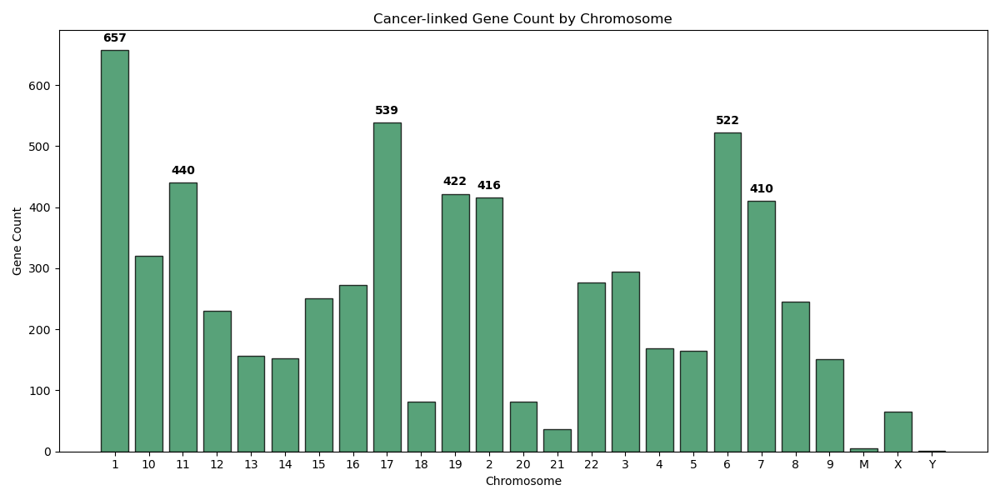
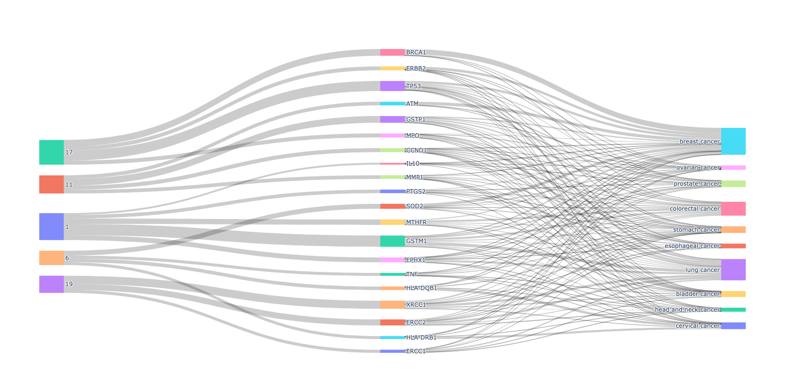

# Cancer Gene–Chromosome Association Analysis  
**Author:** Teddy Pomianek  
**Course:** CS3200 – Introduction to Databases, Northeastern University with Prof. Carter Ithier
 
---
 
## Project Overview
This project analyzes the relationship between human chromosomes and cancer-associated genes using data from the Genetic Association Database (GAD).  
 
The goal was to identify the chromosomes that appear most frequently in cancer association records in the biological literature contained in GAD. Each record in GAD is one study's finding about one gene and one disease. SQL was used for data management and Python for visualization.
 
---
 
## Data Source
- Genetic Association Database (GAD), NCBI  
- Becker KG et al., *Nucleic Acids Research* (2004)  
- https://geneticassociationdb.nih.gov/
---
 
## Tools and Technologies
- MySQL for data storage, cleaning, and aggregation  
- Python (pandas, matplotlib, plotly) for analysis and visualization  
- Git and GitHub for version control  
---
 
## SQL Process
1. Created and populated the `gad` database using data from `gad.csv`.  
2. Removed null or blank chromosome values.  
3. Counted the cancer association records for each gene and chromosome using the following query:
```sql
SELECT gene AS gene_symbol, chromosome, gene_name, COUNT(*) AS gene_count
FROM gad
WHERE disease_class = 'CANCER'
  AND chromosome IS NOT NULL
  AND chromosome <> ''
GROUP BY chromosome, gene, gene_name
ORDER BY chromosome, gene_count DESC;
```
 
4. After running this SELECT query, the results were exported as "cancer_genes.csv" inside MySQLWorkbench.
`gene_count` is the number of cancer association records for each gene, not a count of genes. A gene studied in many cancer papers has a high `gene_count`. Summing `gene_count` by chromosome gives each chromosome's total number of cancer association records.
 
---
 
### Sample Data from "cancer_genes.csv"
First 5 rows of "cancer_genes.csv":
```
gene_symbol,chromosome,gene_name,gene_count
GSTM1, 1, "Glutathione S-transferase M1", 164
MTHFR, 1, "Chromosome 1 open reading frame 167", 82
EPHX1, 1, "Epoxide hydrolase 1, microsomal (xenobiotic)", 57
IL10, 1, "Interleukin 10", 42
PTGS2, 1, "Prostaglandin-endoperoxide synthase 2 (prostaglandin G/H synthase andcyclooxygenase)", 38
```
 
The gene name listed for MTHFR comes directly from the source data and is incorrect. MTHFR is methylenetetrahydrofolate reductase.
 
---
 
## Visualizations and Results
 
### Cancer Association Records by Chromosome Histogram

 
Chromosomes 1, 17, 6, and 11 had the most cancer association records, with 657, 539, 522, and 440 records respectively.
 
These counts reflect how often genes on each chromosome appear in cancer research, not the number of cancer-linked genes on each chromosome. Ranked by number of distinct genes instead, the top chromosomes are 1 (71 genes), 19 (60), and 11 (57). Chromosome size and research focus both shape the ranking. Chromosome 1 is the largest human chromosome, and chromosome 17 contains heavily studied cancer genes such as TP53, which alone accounts for 181 of chromosome 17's 539 records.
 
### Top 5 Chromosomes Mapped to Their Most Studied Genes, Those to Cancer Phenotypes Associated with Those Genes

 
The Sankey diagram depicted above has 3 levels. The left side of the diagram shows the 5 chromosomes with the highest number of cancer association records in GAD. The middle shows the 20 most frequently studied genes in cancer research on those chromosomes. The right side shows the 10 most common cancer phenotypes those genes are associated with. 
 
Using the diagram, it is possible to see which cancer types are connected to specific genes. Breast cancer (with incoming flow count 20), stomach cancer (18), and colorectal cancer (16) are the top 3 cancer types associated with the largest number of distinct genes in the diagram. This shows that these cancer types have been studied across a wider range of genes. It does not show that these cancers are caused by a larger range of genetic mechanisms, since association records measure research activity rather than cause. 
 
Another conclusion supported by the diagram is how different genes, chromosomes, and cancer types have different thicknesses, which show how many study records connect them within this diagram rather than overall in the GAD database. More common types of cancer including breast cancer, lung cancer, and colorectal cancer are included in more studies associated with the most studied genes. 
 
For genes such as GSTM1 commonly studied alongside common cancer types, it might be useful to commit more research in connection to less common cancer types. GSTM1 is connected to 10 different cancer types, some more common than others. Studying its interactions with rarer types of cancer may give way to conclusions about how it interacts with more common types of cancer.
 
Overall, this Sankey diagram can be a good indicator of areas of cancer research that need more attention. In the future there could be many useful alterations made for this diagram. For example, instead of listing most common cancer phenotypes related to these genes, the diagram could also compare the rarest types of cancer with fewer overall publications in GAD.
 
---
 
## Notes on Interpretation
- **Association results vary.** GAD records whether each study found an association. Of the 6,362 cancer records, 1,546 report an association (Y), 830 report no association (N), 47 report a possible association (P), and 3,939 are blank. The counts in this project include all of them, so they measure how often genes are studied in cancer research rather than how often they are confirmed to be linked to cancer.
- **Duplicate records.** 235 rows in GAD are identical apart from their ID and are counted in the totals.
- **Single table design.** The data was loaded into one table that mirrors the CSV. A normalized design with separate genes, studies, and phenotypes tables, linked by primary and foreign keys, would prevent duplicate and inconsistent entries at load time.
- **Chromosome sorting.** Chromosome is stored as text, so SQL sorts it as 1, 10, 11, 2 rather than numerically.
 
